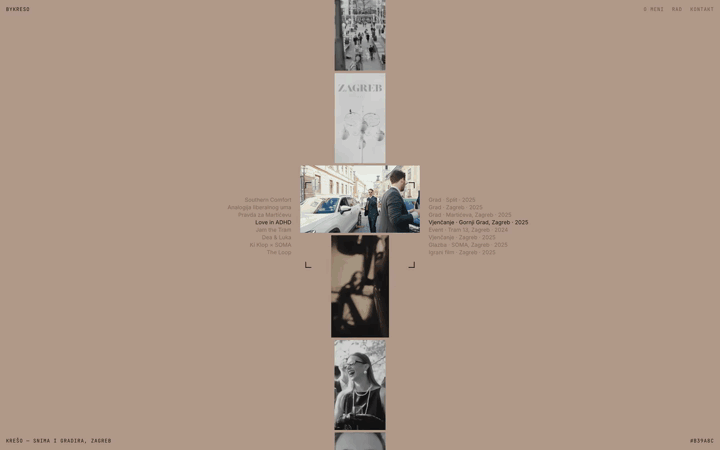

# bykreso



Live at [bykreso.com](https://bykreso.com/).

Portfolio for Krešo, who films and grades weddings, bands, bars and cities in Zagreb. Rebuilt from a screen recording of the original after it was lost.

```sh
npm install
npm run dev
```

## How it works

- **Hero** (`src/components/FilmStrip.tsx`): a looping strip of greyscale clips under four corner marks. The framed one plays in colour, and the lists on both sides turn with it. The wheel drives the strip near the centre column, and the page scrolls from the sides. Reworked from creative-kit's `viewfinder-strip`.
- **Page colour** (`src/lib/page-color.ts`): each film has a colour (`src/data/films.ts`). The whole page fades to it while that film is framed, ink flips on dark films, and the hex shows bottom right.
- **O meni / Kontakt** (`src/components/Spine.tsx`): text on a centre hairline, after creative-kit's `spine-text`.
- **Rad** (`src/components/Work.tsx`): every film as a barcode strip, one column per frame. Hovering floods a row with the film's colour.
- **Player** (`src/components/Player.tsx`): grows out of the clicked clip. Arrow keys switch films, Esc closes, and you can toggle sound.

Fonts: Inter and JetBrains Mono, self-hosted in `public/fonts` (latin and latin-ext).

## First second and weight

- Before any script runs, `index.html` paints the first film's colour with the strapline and its hex, and preloads both fonts and the first cover. The page keeps that colour until the strip has risen in, then follows the framed film (the browser bar on phones too).
- The strip shows 480px covers (`public/media/thumb`) and plays light 10 s loops (`public/media/preview`); only the player loads the full clip. Only tiles on the strip play, and nothing turns or plays while the strip is scrolled away, under the player, or with reduced motion.
- `public/og.jpg` (1200×630) is a screenshot of the first screen at 1600×840 with reduced motion on.

## Media

Clips and covers are in `public/media/<id>.mp4|jpg` and come from [@bykreso](https://www.instagram.com/bykreso/). The strip's loops and covers are made from them on macOS with:

```sh
swiftc -O -o /tmp/preview scripts/preview.swift
/tmp/preview public/media/<id>.mp4 public/media/preview/<id>.mp4 480 1 10 450
sips -Z 480 -s format jpeg -s formatOptions 72 public/media/<id>.jpg --out public/media/thumb/<id>.jpg
```

A landscape poster needs `wide: true` in `src/data/films.ts`. Barcodes are in `public/barcodes/<id>.png` and are made on macOS with:

```sh
swiftc -O -o /tmp/barcode scripts/barcode.swift
/tmp/barcode public/media/<id>.mp4 public/barcodes/<id>.png 600
```

## Deploy

Cloudflare Pages (bykreso.com), not connected to git:

```sh
npm run build
npx wrangler pages deploy dist --project-name bykreso --branch main
```
